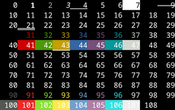

# Spis treści
- [Operatory](#operatory)
- [Komentarze](#komentarze)
- [Nagłówki](#nagłówki)
- [Zmienne i typy danych](#zmienne-i-typy-danych)
- [Metody zmiennych](#metody-zmiennych)
- [Konsola](#konsola)
- [Instrukcje warunkowe](#instrukcje-warunkowe)
- [Pętle](#pętle)
- [Funkcje](#funkcje)
- [Działania na plikach](#działania-na-plikach)
- [Programowanie obiektowe](#programowanie-obiektowe)
---
# Operatory
### Matematyczne

| Priorytet | Operator | Nazwa                          | Przykład      |
| --------- | -------- | ------------------------------ | ------------- |
| 1         | `()`     | Nawiasy                        | `(2 + 3) * 4` |
| 2         | `+x`     | Jednoargumentowy plus          | `+x`          |
| 2         | `-x`     | Jednoargumentowy minus         | `-x`          |
| 2         | `++`     | Inkrementacja                  | `++x`         |
| 2         | `--`     | Dekrementacja                  | `--x`         |
| 2         | `(typ)`  | Rzutowanie w stylu C           | `(double)x`   |
| 3         | `*`      | Mnożenie                       | `a * b`       |
| 3         | `/`      | Dzielenie                      | `a / b`       |
| 3         | `%`      | Reszta z dzielenia całkowitego | `a % b`       |
| 4         | `+`      | Dodawanie                      | `a + b`       |
| 4         | `-`      | Odejmowanie                    | `a - b`       |
> `++x` oraz `x++` rożnią się kolejnością inkrementacji zmiennej
```cpp
int x = 5;
int y = ++x;
// x = 6
// y = 6
```
```cpp
int x = 5;
int y = x++;
// x = 6
// y = 5
```
---
### Warunkowe

| Operator | Znaczenie          | Przykład |
| -------- | ------------------ | -------- |
| `==`     | Równa się          | `x == 5` |
| `!=`     | Nie równa się      | `x != 5` |
| `>`      | Większe niż        | `x > 5`  |
| `<`      | Mniejsze niż       | `x < 5`  |
| `>=`     | Większe lub równe  | `x >= 5` |
| `<=`     | Mniejsze lub równe | `x <= 5` |

---
# Komentarze
```cpp
// jedna linijka

/* wiele
   roznych
   linijek */
```
> nie są czytane przez komputer
---
# "Nagłówki"
### Dołączanie bibliotek
```cpp
//input (cin) / output (cout) stream
#include <iostream> 

// typy danych
#include <string>
#include <vector>
#include <array>
#include <map>
#include <set>
#include <unordered_map>

#include <ctype.h>
```
> Zawierają przydatne funkcje itp
---
### Używanie przestrzeni nazw
```cpp
using namespace std;
```
> neguję potrzebę pisania namespace:: przed każdą funkcją
---
# Zmienne i typy danych
### Typy danych
```cpp
int a ; 
// tylko liczby calkowite: 1, 2, 3...
// od -2 147 483 648 do 2 147 483 647

float b; // o połowę mniejszy od double
// liczby zmiennoprzecinkowe: 0.1, 0.12, 0.123...
// ograniczenie do okolo 7 cyfr znaczacych

double c;
// liczby zmiennoprzecinkowe: 0.1, 0.12, 0.123...
// ograniczenie do okolo 16 cyfr znaczacych

char d;
// przechowuje znak: 'a', 'b', 'c'...
// ogranicza sie do 1 znaku

string e;
// ciag znakow: "abc", "abcdef"...
// ciezko okreslic maksymalny rozmiar

bool f;
// wartość logiczna: false (0), true, (1)
// mozliwe tylko dwie wartości
```
### Array
```cpp
// ARRAY (nie mozna zmieniac rozmiaru tablicy!!!)
string g[] = {"raz", "dwa"};
// lub (rozmiar przypisuje kompilator lub recznie)
string g[2] = {"raz", "dwa"};
// przechowuje wiele wartosci

// wywolanie elementu
cout << g[0];

// przypisanie elementu
g[1] = "trzy";
```
> służą do przechowywania danych, \* potrzebują include
---
### Warianty typów
```cpp
const int a; // niezmienna wartosc
constexpr int b; // oblicza wartosc podczas kompilacji
mutable int c; // pozwala zmieniac wartosc pomimo const
auto int d; // kompilator sam nadaje typ
decltype(a) e; // tworzy taki sam typ jak podana zmienna
static int f; // sachowuje wartosc miedzy wywolaniami funkcji
thread_local int g; // osobna zmienna na kazdy watek
extern int h; // zmienna definiowana w innym miejscu

signed int b; // ze znakiem (-)
unsigned int c; // bez znaków
short int d; // krotszy wariant
long int e; // dluzszy
```
> nadają dodatkowe informacje kompilatorowi o zmiennych
---
# Metody zmiennych
### string
```cpp
str1 = "Jan";
str2 = "Kowalski";

str1.append(str2);
// dodaje ciagi znakow
str1.substr(pozycja, dlugosc);
// zwraca fragment
str1.insert(pozycja, "abc");
//wstawia fragment
str1.erase(pozycja, dlugosc);
// usuwa fragment
str1.replace(pozycja, dlugosc, "abc");
// zastepuje fragment
str1.clear();
// usuwa tekst
```
```cpp
str1.push_back('x');
// dodaje znak na koncu
str1.pop_back()
// usuwa ostatni znak
```
```cpp
str1.compare(str2);
// porownuje stringi
str1.starts_with("Ala");
// [C++ 20] sprawdza poczatek tekstu
str1.ends_with("kot");
// [C++ 20] sprawdza koniec tekstu
str1.contains("ma");
// [C++ 23] sprawdza czy zawiera fragment
```
```cpp
str1.size();
str1.lenght();
// zwraca liczbe znakow
```
```cpp
str1.empty();
// sprawdza czy tekst jest pusty
```
```cpp
str.find("kot");
// znajduje pierwsze wystapienie
```
```cpp
str1[0] -= 32; // przesunie o 32 na tablicy znakow, czyli zamieni mala na wielka litere
// string dziala jako ciag znakow, wiec mozemy wczytac / zmienic char o danym id
```
---
# Konsola
### Input
```cpp
int zmienna1, zmienna2;
cin >> zmienna1 >> zmienna2;
```
```cpp
getline(cin, zmienna)
// obsluguje spacje
```
> Wprowadza dane poprzez konsolę
---
### Output
```cpp
int zmienna = 3;
cout "\033[1;30m" << "tekst " << zmienna << endl;
```


| Znak | Opis |
|---|---|
| `\n` | przechodzi do nowej linii |
| `\t` | wstawia tabulator (poziomy) |
| `\v` | wstawia tabulator pionowy |
| `\r` | przesuwa kursor na poczatek biezacej linii |
| `\b` | przesuwa kursor o jeden znak wstecz |
| `\f` | znak wysuniecia strony |
| `\a` | sygnal dzwiekowy (jesli obslugiwany) |
| `\\` | wstawia \ (backslash) |
| `\'` | wstawia ' (apostrof) |
| `\"` | wstawia " (cudzysłów) |
| `\?` | wstawia ? |
| `\0` | znak o wartości zero |

| Manipulator      | Opis                                       |
| ---------------- | ------------------------------------------ |
| `endl`           | nowa linia + oproznienie bufora            |
| `flush`          | oproznia bufor                             |
| `ends`           | wstawia znak `\0`                          |
| `boolalpha`      | wyswietla true/false zamiast 1/0           |
| `noboolalpha`    | analogicznie, wyswietla 1/0                |
| `dec`            | system dziesiętny                          |
| `hex`            | system szesnastkowy                        |
| `oct`            | system osemkowy                            |
| `showbase`       | wyswietla przedrostek systemu liczbowego   |
| `noshowbase`     | analogicznie, nie wyswietla                |
| `showpos`        | dodaje + przed liczby nieujemne            |
| `noshowpos`      | analogicznie, nie dodaje                   |
| `uppercase`      | wielkie litery                             |
| `nouppercase`    | analogicznie...                            |
| `setw()`         | ustawia szerokosc                          |
| `left`           | wyrownuje do lewej (przy danej szerokosci) |
| `right`          | wyrownuje do prawej (...)                  |
| `internal`       | znak do lewej, wartosc do prawej (...)     |
| `setprecision()` | ustawia liczbe miejsx po przecinku         |
| `fixed`          | wyswietla dana ilosc miejsc po przecinku   |
| `scientific`     | notacja wykladnicza                        |
| `defaultfloat`   | analogicznie                               |
| `unitbuf`        | oproznia bufor po kazdej operacji wyjscia  |
| `nounitbuf`      | analogicznie                               |

>Wyświetla dane w konsoli odpowiednio je formatując
---
# Instrukcje warunkowe
```cpp
int num = 1;

if (num == 1)
	Wykonaj();
else if (num == 2)
	Wykonaj();
else
	return 0;
```
```cpp
switch(num)
{
	case 1:
		Wykonaj();
		break;
	case 2:
		Wykonaj();
		break;
	default:
		return 0;
}
```
> Przy większej ilości linii instrukcje powinny być zapisane w {}
---
# Pętle
### While, do while, for
```cpp
bool loop = true;

while (true) 
{
	// wykona sie tylko gdy warunek jest spelniony
}
```
```cpp
do
{
	// wykona sie 1 raz i powtorzy jesli warunek jest spelniony
} while (loop == false)
```
```cpp
for(int i = 0; i < 10; i++)
{
	// precyzuje zmienna poczatkowa, warunek oraz zmiane / increment
}
```
---
### For each (array)
```cpp
string arr[] = {"Abc", "Abcd", "Abcde"};

for(string i: arr)
	cout << i << endl;
```
---
### Manipulacja pętlami
```cpp
while(true)
	break; // konczy petle
```
```cpp
for(int i = 0; i < 10; i++)
	continue; // skipuje 1 iteracje
```
> Ponawiają daną instrukcję do czasu, gdy warunek zostaje spełniony, bądź zostaną przerwane
---
# Funkcje
### Definiowanie / wywoływanie
```cpp
// funkcja zwracajaca wartosc dodawania argumentow
int Funkcja(int a, int b) 
{
	return a + b;
}

cout << Funkcja(1, 2);
// wywolanie funkcji
```
---
### Zmiana poprzez referencję
```cpp
void oblicz(int &suma, int &roznica) {
	suma = 10 + 5;
	roznica = 10 - 5;
}

int main() {
	int s, r;
	oblicz(s, r);
	
	// s = 15, r = 5
}
```
---
# Działania na plikach
```cpp
#include <iostream>
#include <fstream>
using namespace std;

int main() 
{
	ofstream filename;
	filename.open("file.txt", ios::out)
	// app - dopisz dane do pliku
	// ate - otworz i ustaw kursor na koncu
	// in - otworz do odczytu
	// out - otworz do zapisu
	// trunc - usuwa zawartosc po otwarciu
	// binary - otwiera w trybie binarnym
	
	filename << "Hello world" << endl;
	filename.close();
}
```
> `ofstream` -> zapis
>` ifstream` -> odczyt
> `fstream ` -> odczyt i zapis
---
# Programowanie obiektowe
### Class
```cpp
class Zwierze {
	public:
		int waga;
		double wzrost;
		
		void text() {
			cout << "lew";
		}
}antylopa, pingwin;

int main() {
	Zwierze lew;
	Zwierze[2];
	// ...
	lew.waga = 120;
	lew.wzrost = 85.5;
	lew.text();
}
```
---
### Struct / Union
```cpp
struct Zwierze {
    int waga;
    double wzrost;
    
    void text() {
		cout << "lew";
	}
}antylopa, pingwin;
// deklaracja zmiennych

int main() {
	Zwierze lew;
	Zwierze[2];
	// ...
	lew.waga = 120;
	lew.wzrost = 85.5;
	lew.text();
}
```
> union działa podobnie do struct, lecz przechowuje **WARTOŚĆ A LUB WARTOŚĆ B LUB WARTOŚĆ C**, wszystkie pola zaczynają się w tym samym miejscu pamięci i wzajemnie nadpisują!

> Struct domyślnie public, a class private, są zbliżone w użyciu
---